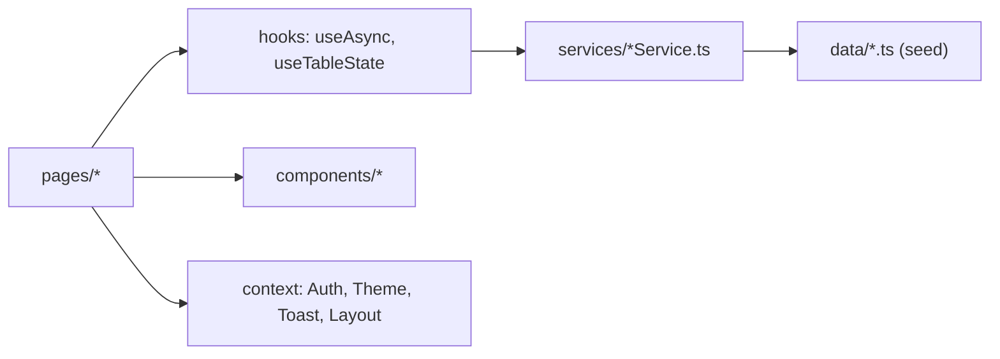

# Developer Guide (one page)

A frontend-only admin panel: React 19 + TypeScript + Vite, React Router 7, CSS Modules, recharts, lucide-react. No backend: all data is mock data held in memory.

## Mental model

1. **Pages** own screen logic. They never import `data/` directly.
2. **Services** are the only data layer. Each keeps a module-level copy of its seed data and returns Promises after a 400 ms fake delay (`services/mockDelay.ts`). Changes survive navigation but reset on refresh. **To add a real backend, rewrite only the service function bodies.**
3. **Components** are generic and know nothing about users, roles or records.

## Where things live

| Folder | Contents |
| --- | --- |
| `routes/` | `AppRoutes` (route table), `ProtectedRoute` / `PublicRoute` (auth guards), `routeTitles` (header titles) |
| `context/` | `xContext.ts` (the context object) + `XProvider.tsx` (state). Read them with `hooks/useX.ts` |
| `components/common` | Button, Input, Select, Modal, ConfirmDialog, Card, Badge, Toast, Empty/Error states, ErrorBoundary |
| `components/table` | `DataTable` (columns config, sorting, loading/empty/error), `TableToolbar`, `TablePagination`, `TableActions` |
| `components/layout` | `AdminLayout` = Sidebar + Header + `<Outlet/>` |
| `pages/` | One folder per screen; Roles and Data use modals instead of sub-routes |
| `types/`, `utils/` | Shared types; formatting, validation, safe localStorage helpers |

## Where state lives

- **Auth flag:** stored in `localStorage` (Remember me) or `sessionStorage` under the key `isAuthenticated`. There is no real authentication. See `context/AuthProvider.tsx`.
- **Profile, theme, sidebar collapsed, preferences:** stored in `localStorage` through `useLocalStorage`. Invalid stored JSON falls back to the defaults.
- **Users / roles / records:** held in memory inside the services.
- **Toasts:** kept in `ToastProvider`. Call `showToast('success' | 'error' | 'warning' | 'info', message)` to show one.

## Example: deleting a user

`UserListPage` loads the list with `useAsync(userService.getUsers)` and passes the result to `useTableState` (search, filter, sort, pagination). The trash icon sets `pendingDelete`, which opens a `ConfirmDialog`. Confirming calls `await userService.deleteUser(id)`, then `showToast(...)`, then `reload()`. While the reload runs, `isFetching` dims the table instead of replacing it with a spinner.

## Adding a new CRUD module (recipe)

1. Add a type in `types/`, seed data in `data/`, and a `fooService` copied from `recordService.ts`.
2. Create `pages/Foo/FooListPage.tsx` by copying `pages/Data/RecordListPage.tsx`, the simplest full CRUD example.
3. Register the route in `routes/AppRoutes.tsx`, the title in `routes/routeTitles.ts`, and the nav item in `components/layout/Sidebar.tsx`.

## Rules the linter will enforce (and why)

- **Component files may only export components.** This is the React Fast Refresh rule, and it's why each context lives in a `.ts` file separate from its `Provider.tsx`.
- **Pass `useAsync` a stable function:** a service method, or `useCallback(() => service.get(id), [id])`. An inline arrow would refetch on every render.
- **Define `searchKeys` / `filterKeys` arrays outside the component.** New arrays on every render defeat `useTableState`'s memoisation.
- **Use `import type` for type-only imports** (required by `verbatimModuleSyntax`). Don't use enums; use union types plus `as const` arrays instead.
- **Use design tokens:** only CSS variables from `src/index.css`. Dark mode works because `<html data-theme="dark">` swaps those variables.

## Commands

`npm run dev` starts the dev server, `npm run build` type-checks and builds, and `npm run lint` runs ESLint. Log in with any non-empty username and password.
